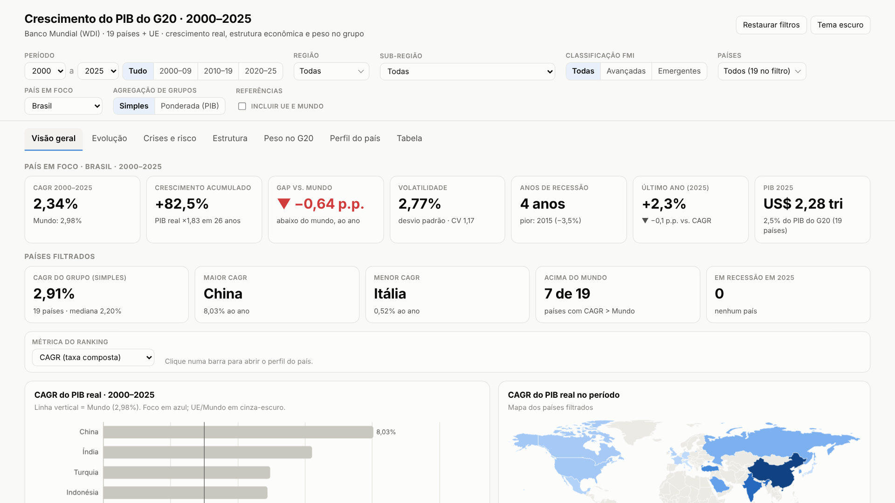

# Crescimento do PIB do G20 · 2000–2025

Banco de dados e dashboard interativo sobre o crescimento econômico dos 19 países do G20 e da União Europeia, de 2000 a 2025.

**🔗 Acesse o dashboard:** `https://marcospiauhy.github.io/g20-pib-dashboard/` *(troque pelo seu link depois de ativar o GitHub Pages)*



## Principais resultados

| País | Crescimento médio (2000–2025) | Destaque |
|---|---|---|
| 🇨🇳 China | 8,0% a.a. | Saiu de ~4% para 21% do PIB do G20; ritmo caiu de ~10% a.a. (anos 2000) para ~5% (2020–25) |
| 🇺🇸 EUA | 2,2% a.a. | Maior economia do grupo, com cerca de 1/3 do PIB do G20 |
| 🇧🇷 Brasil | 2,3% a.a. | 9º de 19, abaixo da média mundial (3,0%); recessão de 2015–16 pesou muito |
| 🇮🇹 Itália | 0,5% a.a. | Pior desempenho; levou 15 anos para voltar ao nível de PIB anterior a 2008 |

## O que tem no dashboard

| Aba | Análises |
|---|---|
| Visão geral | KPIs do país em foco, ranking por 7 métricas, mapa e treemap do PIB |
| Evolução | Índice do PIB real (base 100), crescimento anual com crises, médias por década, small multiples |
| Crises e risco | Heatmap país × ano, risco × retorno, tempo de recuperação após crises |
| Estrutura | Indústria e agro (% do PIB), commodities × volatilidade, abertura comercial, total × per capita |
| Peso no G20 | Participação no PIB do grupo e contribuição de cada região ao crescimento |
| Perfil do país | Região mais importante, setores-chave, exportações e comparação com referências |
| Tabela | Resumo ordenável e exportação da base filtrada em CSV |

Filtros: período, região, sub-região, classificação FMI, países, país em foco, agregação simples ou ponderada pelo PIB e inclusão de UE/Mundo.

## Estrutura do repositório

```
├── index.html                          # dashboard (arquivo único, funciona offline)
├── dados/
│   ├── PIB_G20_2000-2025.xlsx          # banco de dados com fórmulas, perfis e fontes
│   └── base_pib_g20_2000-2025.csv      # base em formato longo (país-ano)
├── imagens/                            # capturas do dashboard
└── video/tour_dashboard.mp4            # tour de 1 minuto
```

Para usar localmente, basta baixar e abrir o `index.html` no navegador.

## Fontes

- **Banco Mundial — World Development Indicators:** crescimento do PIB real e per capita, PIB em US$, agropecuária, indústria, exportações, combustíveis e minérios. [data.worldbank.org](https://data.worldbank.org/indicator/NY.GDP.MKTP.KD.ZG) · Licença CC BY 4.0
- **Institutos nacionais** (IBGE, Insee, ONS, INEGI, TÜİK, entre outros) para a região mais importante de cada país. Links individuais na aba *Perfil_Paises* da planilha.
- **Eurostat** para a participação dos países no PIB da União Europeia.

## Notas e limitações

- CAGR = taxa média geométrica anual do período.
- Valores de 2024–2025 são preliminares e podem ser revisados.
- A Índia é reportada em ano fiscal (abril a março).
- O PIB em US$ correntes inclui efeito do câmbio.
- A UE não entra nos agregados para não contar Alemanha, França e Itália duas vezes.
- A União Africana não tem série agregada no Banco Mundial e ficou de fora.

## Como foi feito

As perguntas, as análises, a estrutura do banco de dados e do dashboard e a revisão dos dados foram conduzidas por mim. Usei IA (Claude) como apoio para acelerar a coleta, os cálculos e a geração do código.

Tecnologias: Python (pandas, openpyxl), HTML/CSS/JavaScript e [Apache ECharts](https://echarts.apache.org/) (licença Apache 2.0, embutido no `index.html`).
